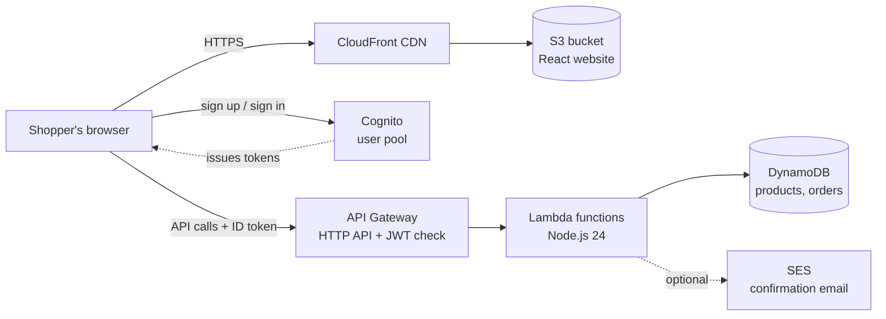

# AWS Serverless Online Store

A complete online store that runs on AWS with no servers to manage: product catalogue, sign-up and login,
cart, checkout with a simulated payment, order history and an admin page.

**Live demo:** _add your CloudFront address here after Step 9 of the guide_



## What each piece does

| Piece | AWS service | Job |
| --- | --- | --- |
| Website | S3 + CloudFront | Serves the React app over HTTPS, worldwide |
| Login | Cognito | Accounts, passwords, email codes, an `admins` group |
| Front door | API Gateway (HTTP API) | Checks the login token, throttles traffic, calls the right function |
| Logic | Lambda (8 functions) | Products, orders, admin actions |
| Data | DynamoDB (2 tables) | `eshop-products`, `eshop-orders` |
| Email (optional) | SES | Order confirmation |
| Setup | CloudFormation via SAM | One file (`template.yaml`) creates everything above |

## Quick start

You need an AWS account, Node.js 24 (LTS), the AWS CLI and the AWS SAM CLI, and `aws configure` done.
The full beginner walkthrough is in the guide that came with this project.

```bash
npm run setup               # installs the tools for the backend tests and the website
npm run deploy:backend      # sam build && sam deploy  (creates everything in AWS, ~5-10 min)
npm run seed                # 12 sample products
npm run configure           # writes frontend/.env from your deployed stack
npm run dev                 # try the website at http://localhost:5173
npm run deploy:site         # build and publish the website; prints your live address
```

Make yourself an admin (replace the three values):

```bash
aws cognito-idp admin-add-user-to-group --user-pool-id <UserPoolId> --username <your-email> --group-name admins
```

Delete everything when finished: `npm run destroy`

## Project map

```
template.yaml            All AWS resources (SAM / CloudFormation)
samconfig.toml           Deploy defaults (stack name "eshop")
backend/src/             Lambda code: products.mjs, orders.mjs, admin.mjs, common.mjs
backend/test/            51 automated tests (success and failure cases)
frontend/                React + Vite website (src/pages, src/components, src/auth.js, src/api.js, src/cart.jsx)
seed/products.json       Sample products
scripts/                 configure, seed, deploy-site, destroy helpers
```

## API

| Method and path | Who | Purpose |
| --- | --- | --- |
| `GET /products` | anyone | List products (`?category=`, `?q=`) |
| `GET /products/{id}` | anyone | One product |
| `POST /orders` | signed in | Place an order (prices and stock re-checked on the server) |
| `GET /orders` | signed in | Your own orders |
| `GET /admin/products` | admins | All products including hidden ones |
| `POST /admin/products` | admins | Add a product |
| `PUT /admin/products/{id}` | admins | Change price, stock, text, visibility |
| `GET /admin/orders` | admins | Recent orders from everyone |

## Design decisions worth knowing

- **Prices never come from the browser.** The order function reads prices from DynamoDB and ignores anything the client sends.
- **Stock cannot go negative or be oversold.** Stock changes and the order are saved in one DynamoDB transaction with a "stock is enough" condition.
- **Money is stored as integer paise**, so there are no rounding errors.
- **The cart lives in the browser** until checkout. A server-side cart is a good next step.
- **Payments are simulated** (`TEST_SUCCESS`, `TEST_DECLINED`, `COD`). No card data is ever collected.
- **Admin rights come from the signed token** (Cognito group `admins`), checked on the server for every admin call.

## Tests

```bash
npm test                      # backend (no AWS needed; uses an in-memory DynamoDB stand-in)
cd frontend && npm test       # website flows with a mocked backend
```

## Ideas for next steps

Server-side cart, real payment gateway (Razorpay or Stripe test mode, with webhook verification), product images
uploaded to S3, search with OpenSearch, sales dashboard with Athena and QuickSight, GitHub Actions deploy using OIDC.
